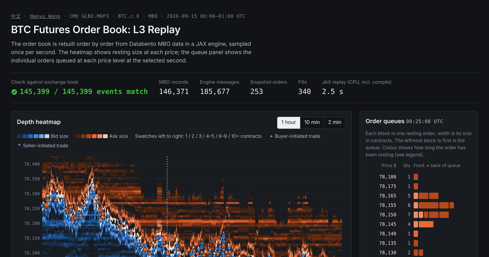

<div align="center">

# Limit Order Book Replay

Explore a recorded order-book sample directly in the browser.

  

[Quick start](#quick-start) · [Project map](#project-map) · [Reproduction guide](docs/REPRODUCIBILITY.md)

</div>

---

## Preview



The English page identifies the recording as **CME GLBX.MDP3 · BTC.c.0 · MBO**, covering **15 September 2026, 00:00–01:00 UTC**.

## Quick start

```powershell
python -m http.server 8000 --bind 127.0.0.1 --directory github_upload
```

Open `http://127.0.0.1:8000/lob-replay/` for English or `http://127.0.0.1:8000/lob-replay/zh.html` for Chinese. No compilation or package installation is required.

## Project map

| File | Purpose |
|---|---|
| [English replay](github_upload/lob-replay/index.html) | Browser visualization |
| [Chinese replay](github_upload/lob-replay/zh.html) | Localized visualization |
| [viz_data.js](github_upload/lob-replay/viz_data.js) | Prebuilt recording data |
| [Packaged homepage](github_upload/index.html) | Parent navigation destination |

## Hosting

Serve or publish the entire `github_upload/` directory. Keep the replay pages and `viz_data.js` together so relative links and data loading work.

## Reproduction boundary

This repository ships a **prebuilt replay**. The raw-feed acquisition, MBO reconstruction and export pipeline are not included. Viewing the recording and regenerating its data are separate workflows.

## Documentation

- [Reproduction guide](docs/REPRODUCIBILITY.md): inputs, execution order and validation limits.
- [Code and artifact map](docs/REPOSITORY_MAP.md): source and configuration paths.

<sub>Research artifacts reflect the recorded experiment settings. Full results were not regenerated during documentation cleanup.</sub>
